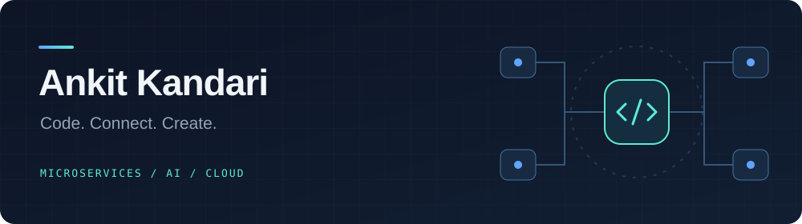

### Curious by nature. Builder by choice.

Microservices · Backend systems · Artificial intelligence

 

**LANGUAGES**

**FRAMEWORKS**

**DATABASES & CACHING**

**MESSAGING & STREAMING**

**CLOUD, INFRASTRUCTURE & MONITORING**

 

---

**Build. Learn. Repeat.**

